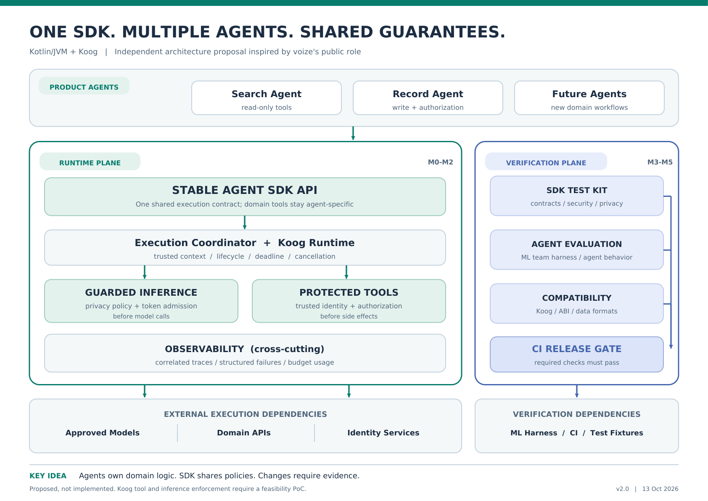

# One SDK. Multiple Agents. Shared Guarantees.

**An independent Kotlin/JVM Agent SDK architecture proposal inspired by voize's public job requirements.**

**Goal: Make new agents easier to build, safer to operate, and simpler to upgrade.**

> **Proposal only:** This is not an implemented SDK or a description of voize's internal architecture. Koog integration and policy enforcement require validation.

[View the one-page architecture PDF](docs/architecture.pdf)

## Why a Shared SDK?

When product teams build multiple AI agents, they should not have to repeatedly implement identity handling, tool authorization, observability, resource limits, and testing infrastructure.

Shared infrastructure reduces duplicated work and helps enforce consistent policies, especially when agents access or modify real business data.

## Architecture

The proposal is a lightweight **Kotlin/JVM SDK built on Koog**, reusing Koog's execution capabilities while providing three shared responsibilities:

- **Trusted Execution:** Carry verified actor context, enforce authorization before protected tool operations, and apply privacy policies and resource budgets to SDK-controlled model calls.
- **Observable Runtime:** Provide consistent tracing, structured error reporting, and resource monitoring without exposing sensitive data in default diagnostics.
- **Stable Contracts:** Offer a narrow, reusable SDK API and compatibility checks to reduce the impact of framework changes on product teams.

**Domain APIs remain outside the SDK boundary.** They retain responsibility for business rules, data access, and independent authorization. These APIs may be internal company services.

## Verification Before Release

Deterministic SDK tests verify security, privacy, error handling, and resource controls.

Agent-level evaluations use the ML team's existing evaluation harness to assess agent behavior after changes.

**ML and domain teams define evaluation acceptance criteria. The SDK team provides evaluation integration and CI release enforcement.** The release gate blocks changes when mandatory checks fail or required evaluation results are missing.

Compatibility checks help detect breaking changes before they affect product teams.

## Validation Plan

1. **Koog feasibility spike:** Verify that mandatory tool authorization and model-call privacy controls can be enforced across the intended execution paths.
2. **Two-agent demonstration:** Build a read-only Search Agent and an authorized-write Record Agent to verify SDK reuse across different tools and workflows without duplicating common infrastructure code.
3. **Incremental hardening:** Add testing utilities, observability, evaluation integration, compatibility checks, and release gates.

The SDK and sample agents are **proposed, not yet implemented**.

---

## Key Design Decisions

### 1. Build on Koog, Not Another Agent Framework

**Decision:** Use Koog for agent execution and a lightweight Kotlin/JVM SDK for shared policies and stable interfaces.

**Why:** Rebuilding agent orchestration would increase complexity and maintenance costs. The SDK should focus on common engineering requirements rather than duplicate Koog's capabilities.

**Trade-off:** Product teams may access supported Koog features, but protected operations must use SDK-controlled execution paths. Unsupported paths are outside the SDK's guarantees.

### 2. Keep Business Logic Outside the SDK

**Decision:** Product agents own their workflows and domain-specific tools. The SDK provides shared execution controls, while domain services own business rules, data access, and final authorization.

**Why:** Clear responsibilities keep the SDK reusable across different agents and prevent coupling to a specific business domain.

**Trade-off:** SDK-level authorization does not replace domain-level authorization. Both boundaries must enforce their own responsibilities.

### 3. Handle Failures and Retries Safely

**Decision:** Distinguish execution failures from uncertain outcomes. Do not blindly retry external write operations after a timeout.

**Why:** A timeout does not necessarily mean an operation failed. The external system may have completed the action, and retrying could create duplicate records or unintended side effects.

**Trade-off:** Safe retries require idempotency support or a reliable way to check operation status. Otherwise, the SDK must report the uncertain outcome rather than assume failure.

### 4. Separate Software Testing from Agent Evaluation

**Decision:** Use deterministic tests to verify SDK contracts and runtime policies, and connect agent-level evaluations to the ML team's existing evaluation harness.

**Why:** Unit and integration tests can confirm that authorization, resource limits, and error handling work as expected. They cannot fully assess whether an agent makes appropriate decisions after a model change.

**Trade-off:** Evaluation criteria remain with ML and domain owners. The SDK enforces agreed release requirements rather than deciding model quality.

### 5. Protect Product Teams from Unnecessary Framework Changes

**Decision:** Keep SDK-facing contracts stable and validate compatibility when Koog or other dependencies change.

**Why:** Product teams should not have to repeatedly modify their agents because of internal framework changes.

**Trade-off:** The SDK should abstract only the interfaces it promises to support rather than duplicate Koog's entire public API.

### Critical Feasibility Risk

The main technical risk is whether Koog allows mandatory security and privacy policies to be enforced across all supported execution paths.

If its extension points are insufficient, I would introduce controlled adapters or gateways and restrict unsupported paths.

The initial PoC must demonstrate that protected operations cannot bypass these controls within the supported execution boundary.

---

**The intended outcome is a reusable SDK that lets product teams focus on agent-specific business logic while sharing security, runtime controls, and verification infrastructure.**
